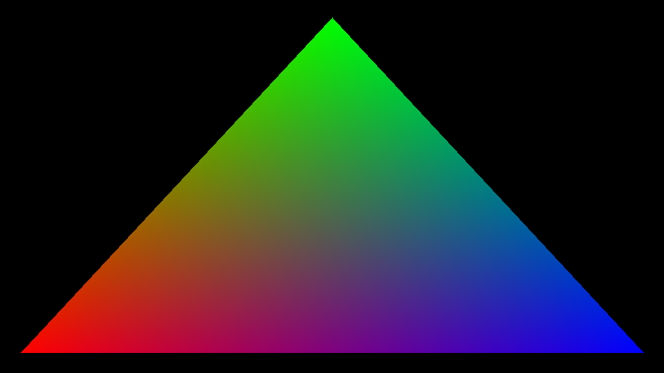
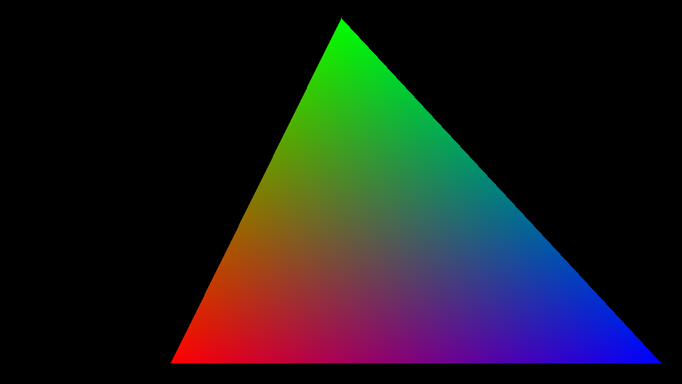
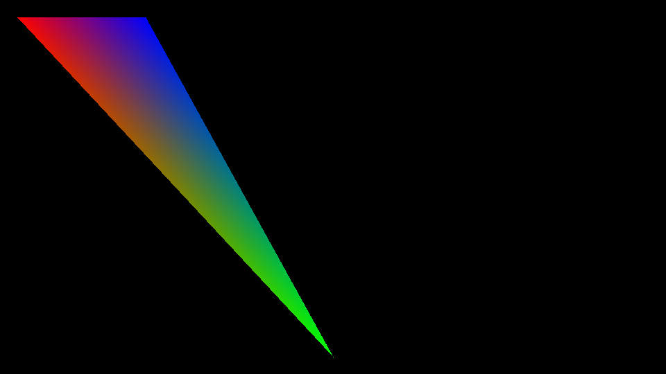

# Lab 3: Triángulo baricéntrico

Relleno de triángulos con rojo, verde y azul usando coordenadas baricéntricas. Está hecho en Zig 0.16.0 y genera tres imágenes BMP de 960 × 540 sobre fondo negro, sin librerías de gráficos.

Desde la carpeta del repositorio:

```powershell
zig build run
zig build test
```

Las imágenes quedan en `imagenes`. Esa carpeta debe existir al ejecutar el programa.

## Cómo funciona

Para cada píxel se calculan tres pesos con áreas con signo. Se divide el área de cada triángulo pequeño entre el área del triángulo original. Los pesos suman 1; si alguno es negativo, el punto está afuera y queda negro.

El primer peso controla el rojo, el segundo el verde y el tercero el azul. Se multiplica cada peso por 255 para obtener el color. Así, en cada vértice aparece su color puro y los colores se mezclan hacia el centro.

En `src/main.zig`, la lista `ejemplos` contiene los tres vértices de cada imagen, en orden rojo, verde y azul. El origen está arriba a la izquierda: x crece hacia la derecha y y hacia abajo. Se pueden cambiar las coordenadas para probar otros triángulos. El cálculo acepta ambos órdenes de recorrido; si los tres puntos están alineados o se repiten y no forman un área, no se dibuja nada. La imagen muestra solamente la parte dentro del lienzo.

## Resultados





## Propuesta para trabajar en dos días

Estos son pasos sugeridos para sesiones reales, no fechas de commits ya realizados:

| Día | Paso | Mensaje sugerido |
| --- | --- | --- |
| 1 | Preparar el proyecto | Preparo la estructura del laboratorio |
| 1 | Calcular los pesos | Agrego las coordenadas baricéntricas |
| 1 | Rellenar con RGB | Pinto el primer triángulo con colores |
| 2 | Probar otras formas | Agrego otros dos triángulos |
| 2 | Revisar casos especiales | Reviso los bordes y los puntos alineados |
| 2 | Documentar y guardar resultados | Agrego las imágenes y las instrucciones |
